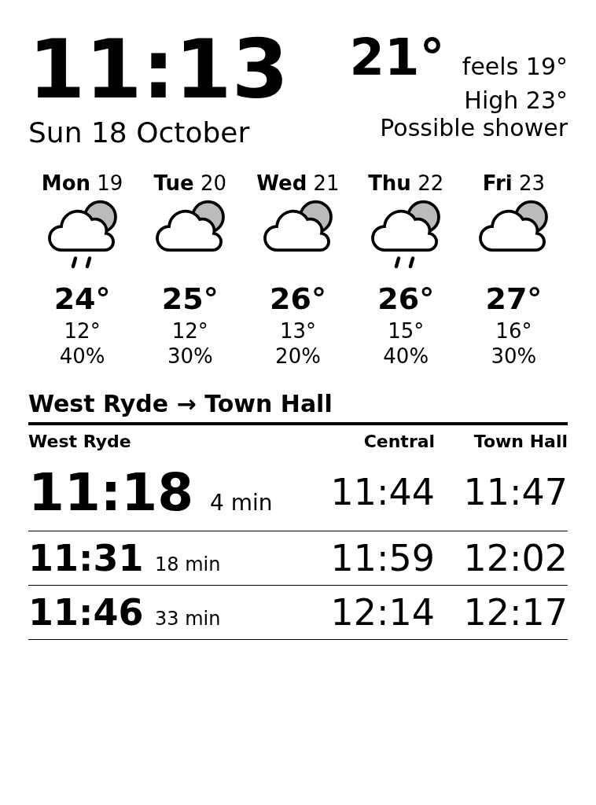

# Kindle e-ink dashboard

An old Kindle Paperwhite 2 used as an always-on wall display. A small server renders the dashboard as an
image, and the Kindle downloads and shows it at the start of every minute.

The screen shows:
- time and date;
- current weather and a 5-day forecast from the Bureau of Meteorology (BOM);
- the next 3 trains on a Sydney Trains route, with arrival times at up to two later stops (Transport for NSW).



The screenshot uses `TRAIN_STOPS=211420:West Ryde,200060:Central,200070:Town Hall` and Sydney Olympic Park weather.

## How it fits together

```
server (Docker)                                 Kindle
┌──────────────────────────────────┐            ┌──────────────────────────────┐
│ server/, port 8090               │            │ /mnt/us/dash/run.sh          │
│  GET /         → HTML dashboard  │  ◄── wget  │  each new minute, or on tap: │
│  GET /dash.png → headless Chrome │    PNG ──► │  fetch dash.png, draw (eips) │
│    screenshot, 8-bit greyscale   │            │  tap the clock → exit        │
│  data: TfNSW trip API,           │            └──────────────────────────────┘
│        BOM forecast + station    │
└──────────────────────────────────┘
```

All drawing happens on the server. The Kindle is too slow to render anything itself.

## Files

| Path | What it is |
|---|---|
| `server/app.rb` | Web server: fetches data, renders the HTML, screenshots it to PNG |
| `server/dash.erb` | Dashboard layout (HTML/CSS). Edit this to change what's shown |
| `server/compose.yml`, `Dockerfile` | Docker setup. Host port **8090**; change it in `compose.yml` |
| `server/check_weather.rb` | Self-check for the weather cache/stale logic |
| `.env.example` | Settings template: TfNSW key, train stops, BOM locations. Copy to `.env` (git-ignored) |
| `device/dash/run.sh` | Kindle loop → `/mnt/us/dash/run.sh` |
| `device/dash/config.example` | Server address for the Kindle. Copy to `/mnt/us/dash/config` |
| `device/documents/Dashboard.sh` | Library launcher → `/mnt/us/documents/Dashboard.sh` |
| `device/emergency.sh` | Optional auto-start hook → `/mnt/us/emergency.sh` |

## Server

```sh
cp .env.example .env        # then fill in your key and locations
cd server
docker compose up -d --build                     # build and (re)start
docker compose logs -f                           # errors show as "weather: …", "trains: …"
docker exec -i server-dash-1 ruby < check_weather.rb   # self-check
```

Preview in a browser at `http://localhost:8090/` (HTML) or `http://localhost:8090/dash.png` (the image the Kindle sees).

### Settings (`.env`)

- **`NSW_TRANSPORT_OPENDATA_API`:** free key from opendata.transport.nsw.gov.au.
- **`TRAIN_STOPS`:** `stopID:Label,...` in travel order, e.g. `213510:Strathfield,200060:Central,200070:Town Hall`.
  - You board at the first stop. Only trains that run through to the last stop with no change are shown.
  - Each later stop gets an arrival-time column. Two or three stops fit on screen.
  - Stop IDs come from the Trip Planner API's `stop_finder`.
- **`BOM_FORECAST_FILE` / `BOM_FORECAST_AREA`:** the state's town-forecast file and a town in it,
  e.g. `IDN11060` (NSW) and `Sydney`.
- **`BOM_OBS_FILE` / `BOM_STATION`:** the state's latest-readings file and a weather station in it,
  e.g. `IDN60920` (NSW) and `Sydney - Observatory Hill`. Pick the nearest station at a similar height.

The names must match the `description` attribute in BOM's XML exactly. Browse the files at
`ftp://ftp.bom.gov.au/anon/gen/fwo/`.

### How the data is used

- **Trains:** one Trip Planner query from the first to the last stop. Arrival times at the other stops come
  from the train's stop list. Real-time estimates are used when available. API times are UTC; the code
  converts them to local time (`TZ` in `compose.yml`).
- **Weather:** BOM's anonymous FTP, which is BOM's channel for automated downloads.
  - The forecast gives the wording ("Possible shower"), min/max and rain chance, and is updated a few times
    a day. Late in the evening BOM drops today's min/max, so the screen leaves them out.
  - The station gives the current and feels-like temperature. Stations don't report conditions, so today's
    forecast wording is shown instead.
  - Fetched every 10 min. If it fails, the last result stays for up to 24 h and shows "as of HH:MM"
    once it's over 30 min old.
  - The BOM app's API (`api.weather.bom.gov.au`) is not used. Its responses say "You must not use, copy or share it".

## Kindle

Tested on a Paperwhite 2 (6th gen), firmware 5.12.2.2, screen 758×1024. Other models need a different
screen size (`W, H` in `app.rb`), touchscreen device and tap coordinates (`run.sh`).

### Setup

1. **Jailbreak** with WinterBreak (see kindlemodding.org). It includes the hotfix and FBInk.
2. **Install KOReader** with KPM: type `;kpm install koreader` in the home search bar. `run.sh` uses
   KOReader's SSH server (dropbear).
3. **SSH:** put your public key in `koreader/settings/SSH/authorized_keys` on the Kindle's USB drive, then
   turn on KOReader's SSH server (in its network settings) with key-only login. It listens on port 2222 as root.
4. **Copy the files** over USB (the Kindle's drive is `/mnt/us`):
   - `device/dash/run.sh` → `dash/run.sh`
   - `device/dash/config.example` → `dash/config`, with your server's address
   - `device/documents/Dashboard.sh` → `documents/Dashboard.sh`
   - optional: `device/emergency.sh` → `emergency.sh` to start the dashboard at boot
5. **Give the Kindle a fixed IP** in your router (DHCP reservation), so SSH always finds it.

### Using it

| To… | Do this |
|---|---|
| Start the dashboard | Tap **Dashboard** in the library, or let `emergency.sh` start it ~30 s after boot |
| Refresh now | Tap anywhere ("Refreshing..." appears) |
| Go back to the normal Kindle | Tap the **clock** (top-left). The Kindle UI takes ~20–30 s to start; this is not a reboot |
| Turn off auto-start | Delete `emergency.sh` from the Kindle's main folder (over USB) |
| Recover if it's stuck | Hold power ~20 s to reboot |

While the dashboard runs, the normal Kindle UI is **stopped**, so taps can't open books.
For a wall mount, power it from a phone charger, not a computer: on a computer it switches to USB drive mode.

### SSH

```sh
ssh -p 2222 root@<kindle-ip>   # or add a "Host kindle" entry to ~/.ssh/config
```

- The SSH server runs while KOReader is open, and `run.sh` starts it too.
- The Kindle has no `scp`. Copy files like this:
  ```sh
  ssh kindle 'cat > /mnt/us/dash/run.sh.new' < device/dash/run.sh
  ssh kindle 'sh -n /mnt/us/dash/run.sh.new && mv /mnt/us/dash/run.sh.new /mnt/us/dash/run.sh'
  ```
  Writing a new file and then `mv` is safe even while the old script is running.

**Restarting the loop over SSH:** do **not** use `pkill -f dash/run.sh`. It also matches your own SSH
command and drops the session. Match the exact command line instead:

```sh
ssh kindle 'for d in /proc/[0-9]*; do case "$(tr "\0" " " < $d/cmdline 2>/dev/null)" in "/bin/sh /mnt/us/dash/run.sh ") kill ${d#/proc/};; esac; done
            (setsid /mnt/us/dash/run.sh >/tmp/dash.log 2>&1 &)'
```

Log: `/tmp/dash.log` on the Kindle. It records each tap's x/y and any failed downloads.

### How auto-start works

The jailbreak installs a boot job (`/etc/upstart/kmc.conf`) that runs `/mnt/us/emergency.sh` each time the
Kindle UI becomes ready. That includes the clock-tap exit, which restarts the UI. So `emergency.sh` leaves a
marker in `/tmp`, which is in RAM and cleared on reboot, and only starts the dashboard once per boot.
No Kindle system files are changed.

### Gotchas

- busybox `kill -0 ""` returns success. Always check that a PID is non-empty first.
- busybox `timeout` syntax is `timeout -t SECS`.
- busybox `ps` truncates command names. Use `/proc/*/cmdline`.
- Touchscreen: `/dev/input/event1`. Its coordinates are screen pixels.
- The Kindle's clock shows the wrong timezone label, but UTC is correct. The time on screen comes from the server anyway.
- USB through some hubs drops every few seconds. Plug the Kindle straight into the computer.

## Data and terms

- Weather data © Commonwealth of Australia, Bureau of Meteorology. BOM's copyright notice allows personal,
  non-commercial use; see bom.gov.au/other/copyright.shtml.
- Transport data © Transport for NSW, from the TfNSW Open Data Hub under its terms (CC BY 4.0).

This project contains no BOM or TfNSW data. It downloads the data when you run it, with your own key.

## License

MIT. See `LICENSE`.
